# MatchPoint · Product Backlog

> **Empresa solicitante:** Nexo Digital Labs
> **Equipo:** Santiago Solano, Maicol Rubiano, Diego Romero y Camilo Bastidas
> **Fase:** Inicio · Backlog de 20 historias planificado en **2 sprints / 2 entregas**, pendiente de revisión con la docente

## Visión

Construir una plataforma funcional de gestión de torneos deportivos y pronósticos con créditos virtuales, control de permisos, trazabilidad de transacciones y liquidación verificable de resultados.

Los créditos **no son dinero**, no tienen valor monetario, no pueden retirarse ni convertirse en dinero real.

## Resumen

- **20 historias** (HU001 a HU020) en **6 épicas**, **12 actividades** y **4 etapas del recorrido**.
- **Sprint 1 · Entrega 1 — Configurar y participar:** 10 historias, 39 SP.
- **Sprint 2 · Entrega 2 — Resolver y controlar:** 10 historias, 43 SP.
- **MoSCoW:** Must 13 · Should 5 · Could 2. Total 82 puntos de historia (estimación inicial, no horas).
- Cada HU tiene el formato **Identificador · Nombre · Descripción · Criterios de aceptación (paso a paso)** y un **mockup** (`assets/img/mockups/HUxxx.png`, editable en `descargas/mockups/HUxxx_mockup.svg`). Los números rojos del mockup corresponden a cada paso.

## Plan de sprints

### Sprint 1 · Entrega 1 — Configurar y participar

**Objetivo:** Tener un recorrido funcional verificable: ingreso por rol, participantes con créditos iniciales, torneos y eventos programados, consulta de eventos y registro de pronósticos con descuento seguro de créditos.

**Se entrega cuando:** Un participante puede ingresar, ver un evento abierto y registrar un pronóstico que descuenta créditos una sola vez; el administrador puede crear, editar y eliminar torneos y programar eventos.

**Historias:** HU001 Iniciar sesión, HU002 Registrar participante, HU003 Crear torneo, HU004 Editar torneo, HU005 Eliminar torneo, HU006 Programar evento, HU007 Consultar torneos y eventos, HU008 Registrar pronóstico, HU009 Asignar créditos iniciales, HU010 Consultar saldo y movimientos · **39 SP**

### Sprint 2 · Entrega 2 — Resolver y controlar

**Objetivo:** Cerrar el ciclo del producto: seguimiento y anulación de pronósticos, cierre de eventos, publicación y corrección de resultados, liquidación sin premios duplicados, ajustes autorizados y auditoría.

**Se entrega cuando:** Un evento puede cerrarse, recibir su resultado oficial y liquidarse una sola vez; los saldos se pueden auditar, conciliar y reportar sin borrar historial.

**Historias:** HU011 Consultar mis pronósticos, HU012 Anular pronóstico, HU013 Cerrar recepción de pronósticos, HU014 Publicar resultado oficial, HU015 Liquidar evento y acreditar premios, HU016 Corregir resultado publicado, HU017 Ajustar créditos autorizados, HU018 Consultar transacciones, HU019 Conciliar saldos, HU020 Generar reporte del torneo · **43 SP**

## Listado del Product Backlog

| ID | Épica | Historia | Prioridad | Sprint | Puntos | Responsable propuesto |
|---|---|---|---|---|---:|---|
| HU001 | Acceso y usuarios | Iniciar sesión | Must | Sprint 1 | 5 | Maicol Rubiano |
| HU002 | Acceso y usuarios | Registrar participante | Must | Sprint 1 | 3 | Diego Romero |
| HU003 | Torneos y eventos | Crear torneo | Must | Sprint 1 | 3 | Diego Romero |
| HU004 | Torneos y eventos | Editar torneo | Should | Sprint 1 | 3 | Diego Romero |
| HU005 | Torneos y eventos | Eliminar torneo | Should | Sprint 1 | 3 | Camilo Bastidas |
| HU006 | Torneos y eventos | Programar evento | Must | Sprint 1 | 5 | Maicol Rubiano |
| HU007 | Pronósticos | Consultar torneos y eventos | Must | Sprint 1 | 3 | Diego Romero |
| HU008 | Pronósticos | Registrar pronóstico | Must | Sprint 1 | 8 | Maicol Rubiano |
| HU009 | Créditos virtuales | Asignar créditos iniciales | Must | Sprint 1 | 3 | Camilo Bastidas |
| HU010 | Créditos virtuales | Consultar saldo y movimientos | Must | Sprint 1 | 3 | Diego Romero |
| HU011 | Pronósticos | Consultar mis pronósticos | Must | Sprint 2 | 3 | Diego Romero |
| HU012 | Pronósticos | Anular pronóstico | Should | Sprint 2 | 5 | Maicol Rubiano |
| HU013 | Resultados y liquidación | Cerrar recepción de pronósticos | Must | Sprint 2 | 3 | Maicol Rubiano |
| HU014 | Resultados y liquidación | Publicar resultado oficial | Must | Sprint 2 | 3 | Maicol Rubiano |
| HU015 | Resultados y liquidación | Liquidar evento y acreditar premios | Must | Sprint 2 | 8 | Maicol Rubiano |
| HU016 | Resultados y liquidación | Corregir resultado publicado | Should | Sprint 2 | 5 | Camilo Bastidas |
| HU017 | Créditos virtuales | Ajustar créditos autorizados | Should | Sprint 2 | 5 | Camilo Bastidas |
| HU018 | Auditoría y reportes | Consultar transacciones | Must | Sprint 2 | 5 | Camilo Bastidas |
| HU019 | Auditoría y reportes | Conciliar saldos | Could | Sprint 2 | 3 | Camilo Bastidas |
| HU020 | Auditoría y reportes | Generar reporte del torneo | Could | Sprint 2 | 3 | Diego Romero |

## Historias de usuario: paso a paso y mockup

### HU001 · Iniciar sesión

**Épica:** Acceso y usuarios · **Actividad:** Ingresar a la plataforma · **Prioridad:** Must · **Sprint 1** · **Puntos:** 5 · **Responsable propuesto:** Maicol Rubiano · Backend Developer · **Dependencias:** Ninguna

| **Identificador** | **HU001** |
|---|---|
| Nombre | Iniciar sesión |
| Descripción | Como usuario de MatchPoint quiero iniciar sesión con mi usuario y contraseña para acceder únicamente a las funciones autorizadas para mi rol. La HU corresponde a la funcionalidad principal del sistema. |
| Criterios de aceptación | 1. Al ingresar a MatchPoint sin una sesión activa, el sistema deberá mostrar la pantalla de inicio de sesión con los campos usuario y contraseña. |
|  | 2. Al presionar «Ingresar», el sistema validará que ambos campos estén diligenciados; si falta alguno, indicará que el campo es obligatorio. |
|  | 3. Si las credenciales son correctas, el sistema redirigirá al usuario al panel que corresponde a su rol (participante o administrador). |
|  | 4. Si las credenciales son incorrectas, el sistema mostrará el mensaje «Usuario o contraseña incorrectos» sin indicar cuál de los dos datos falló. |
|  | 5. Al seleccionar «Cerrar sesión», la sesión deberá invalidarse y no será posible volver a las pantallas privadas con el botón Atrás. |
|  | 6. En caso que un participante intente usar una función administrativa, el sistema deberá rechazar la operación aunque la petición se envíe directamente al servidor. |

**Mockup:** Pantalla de inicio de sesión con validación de campos y mensaje de error genérico.  
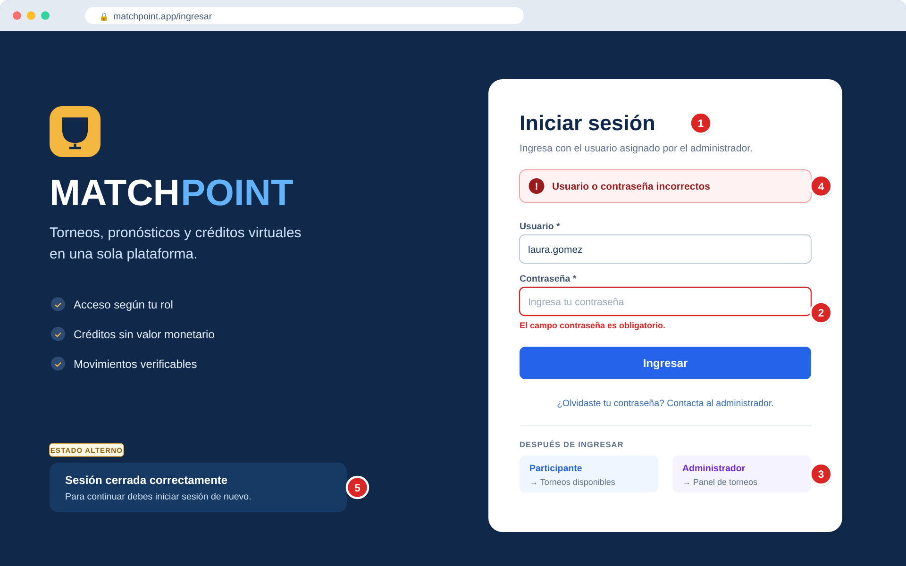  
SVG editable: `descargas/mockups/HU001_mockup.svg`

> **Nota:** Incluye el control de permisos por rol desde el primer sprint.

### HU002 · Registrar participante

**Épica:** Acceso y usuarios · **Actividad:** Gestionar participantes · **Prioridad:** Must · **Sprint 1** · **Puntos:** 3 · **Responsable propuesto:** Diego Romero · Frontend Developer · **Dependencias:** HU001

| **Identificador** | **HU002** |
|---|---|
| Nombre | Registrar participante |
| Descripción | Como administrador quiero registrar participantes para que puedan ingresar a MatchPoint y participar en los torneos. La HU corresponde a la funcionalidad principal del sistema. |
| Criterios de aceptación | 1. Al seleccionar la opción «Nuevo participante» desde la lista de participantes, el sistema deberá mostrar el formulario de registro. |
|  | 2. El sistema validará los campos obligatorios (nombre completo, correo y usuario) y el formato del correo antes de guardar. |
|  | 3. Si el correo o el usuario ya están registrados, el sistema indicará que no es posible crear un participante duplicado. |
|  | 4. Al confirmar el registro, el participante deberá aparecer en la lista de participantes con estado «Activo» y su saldo inicial de créditos (HU009). |
|  | 5. El administrador puede elegir cancelar la operación, por lo que no se crea ningún registro y se regresa a la lista de participantes. |
|  | 6. En caso de error al guardar, se debe notificar al administrador y conservar los datos diligenciados en el formulario. |

**Mockup:** Lista de participantes con el diálogo «Nuevo participante» y validación de correo duplicado.  
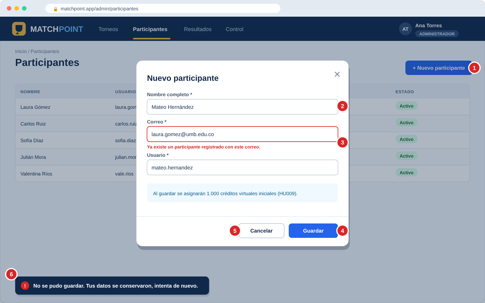  
SVG editable: `descargas/mockups/HU002_mockup.svg`

### HU003 · Crear torneo

**Épica:** Torneos y eventos · **Actividad:** Gestionar torneos · **Prioridad:** Must · **Sprint 1** · **Puntos:** 3 · **Responsable propuesto:** Diego Romero · Frontend Developer · **Dependencias:** HU001

| **Identificador** | **HU003** |
|---|---|
| Nombre | Crear torneo |
| Descripción | Como administrador quiero crear un torneo deportivo para organizar sus eventos y habilitar la participación. La HU corresponde a la funcionalidad principal del sistema. |
| Criterios de aceptación | 1. Al seleccionar la opción «Crear torneo» desde la lista de torneos, el sistema deberá mostrar el formulario con nombre, deporte, fecha de inicio, fecha de fin y descripción. |
|  | 2. El sistema validará que los campos obligatorios estén completos y que la fecha de fin no sea anterior a la fecha de inicio. |
|  | 3. Si ya existe un torneo con el mismo nombre en las mismas fechas, el sistema advertirá el duplicado y no lo guardará. |
|  | 4. Al confirmar la operación, el torneo se guardará con estado «Programado» y deberá aparecer en la lista de torneos. |
|  | 5. El administrador puede elegir cancelar la operación, por lo que ningún dato se guardará. |
|  | 6. En caso de error al guardar el torneo, se debe notificar al administrador y redirigirse a la lista original de torneos. |

**Mockup:** Formulario de creación de torneo con validación de fechas y vista previa.  
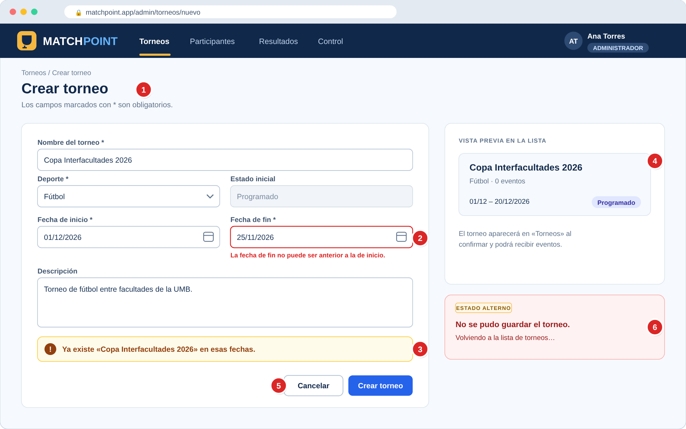  
SVG editable: `descargas/mockups/HU003_mockup.svg`

### HU004 · Editar torneo

**Épica:** Torneos y eventos · **Actividad:** Gestionar torneos · **Prioridad:** Should · **Sprint 1** · **Puntos:** 3 · **Responsable propuesto:** Diego Romero · Frontend Developer · **Dependencias:** HU003

| **Identificador** | **HU004** |
|---|---|
| Nombre | Editar torneo |
| Descripción | Como administrador quiero editar los datos de un torneo para corregir o actualizar su información sin afectar los pronósticos registrados. La HU corresponde a la funcionalidad de gestión del sistema. |
| Criterios de aceptación | 1. Al seleccionar la opción «Editar» en un torneo de la lista, el sistema deberá mostrar el formulario con los datos actuales cargados. |
|  | 2. El sistema permitirá modificar nombre, descripción y fechas mientras el torneo no esté en estado «Finalizado». |
|  | 3. Si el torneo tiene eventos programados, el sistema no permitirá fechas que dejen eventos por fuera del rango del torneo e indicará el motivo. |
|  | 4. Al confirmar los cambios, el sistema aplicará las mismas validaciones de la creación y la lista mostrará los datos actualizados. |
|  | 5. El administrador puede elegir cancelar la operación, por lo que el torneo deberá seguir con sus datos originales. |
|  | 6. Cada modificación quedará registrada con el usuario que la realizó y la fecha del cambio. |

**Mockup:** Formulario de edición con datos cargados, aviso de eventos asociados e historial de cambios.  
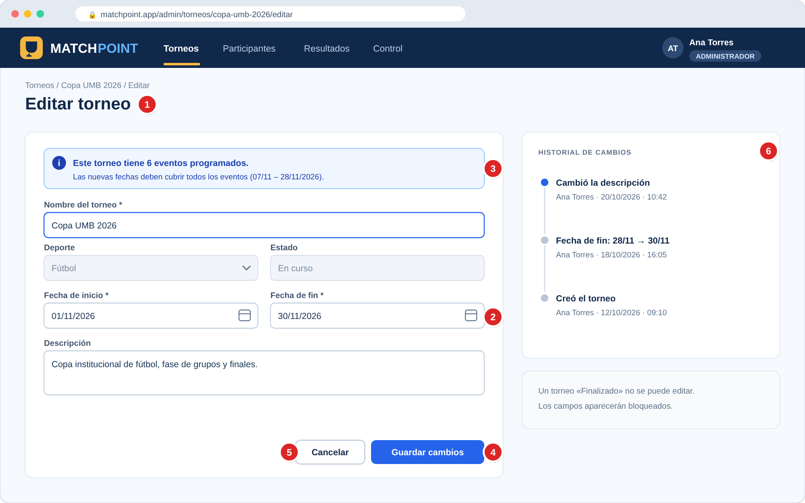  
SVG editable: `descargas/mockups/HU004_mockup.svg`

### HU005 · Eliminar torneo

**Épica:** Torneos y eventos · **Actividad:** Gestionar torneos · **Prioridad:** Should · **Sprint 1** · **Puntos:** 3 · **Responsable propuesto:** Camilo Bastidas · Database Administrator (DBA) · **Dependencias:** HU003

| **Identificador** | **HU005** |
|---|---|
| Nombre | Eliminar torneo |
| Descripción | Como administrador quiero eliminar un torneo para retirarlo de la plataforma en caso de que ya no se necesite, siempre y cuando no tenga eventos asociados. La HU corresponde a la funcionalidad de gestión del sistema. |
| Criterios de aceptación | 1. Al seleccionar la opción «Eliminar torneo» desde la lista de torneos, el sistema deberá validar si el torneo tiene eventos asociados. |
|  | 2. Si el torneo que se quiere eliminar no tiene eventos asociados, el sistema le presentará un cuadro de diálogo pidiendo confirmar la transacción. |
|  | 3. Al confirmar la operación, el torneo debe desaparecer de la lista de torneos. |
|  | 4. El administrador puede elegir cancelar la operación, por lo que el registro deberá seguir en la lista de torneos. |
|  | 5. En caso de error al eliminar el torneo, se debe notificar al administrador y redirigirse a la lista original de torneos. |
|  | 6. En caso que el torneo que se quiere eliminar tenga eventos asociados, el sistema deberá indicarle que no es posible realizar la operación porque el torneo está vinculado a uno o más eventos. |

**Mockup:** Lista de torneos con diálogo de confirmación y mensaje cuando el torneo tiene eventos.  
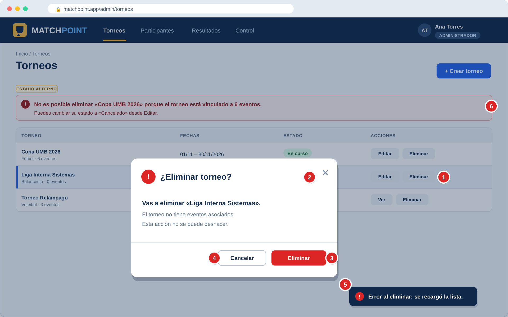  
SVG editable: `descargas/mockups/HU005_mockup.svg`

### HU006 · Programar evento

**Épica:** Torneos y eventos · **Actividad:** Programar eventos · **Prioridad:** Must · **Sprint 1** · **Puntos:** 5 · **Responsable propuesto:** Maicol Rubiano · Backend Developer · **Dependencias:** HU003

| **Identificador** | **HU006** |
|---|---|
| Nombre | Programar evento |
| Descripción | Como administrador quiero programar un evento dentro de un torneo para definir los contendientes, la fecha límite para pronosticar, el costo y el premio en créditos. La HU corresponde a la funcionalidad principal del sistema. |
| Criterios de aceptación | 1. Al seleccionar la opción «Agregar evento» dentro del detalle de un torneo, el sistema deberá mostrar el formulario del encuentro. |
|  | 2. El administrador registrará los dos contendientes, la fecha y hora del encuentro, la fecha límite para pronosticar, el costo de participación y el premio por acierto en créditos. |
|  | 3. El sistema validará que la fecha límite sea anterior al inicio del encuentro y que ambas fechas estén dentro del rango del torneo. |
|  | 4. Las opciones de pronóstico (Local, Empate y Visitante) quedarán asociadas al evento; el sistema no aceptará el mismo contendiente en los dos lados. |
|  | 5. Al confirmar la operación, el evento deberá aparecer en el calendario del torneo con estado «Abierto». |
|  | 6. En caso que alguna validación falle, el sistema señalará el campo con error y no guardará el evento. |

**Mockup:** Formulario de evento con opciones de pronóstico, validación de fecha límite y calendario del torneo.  
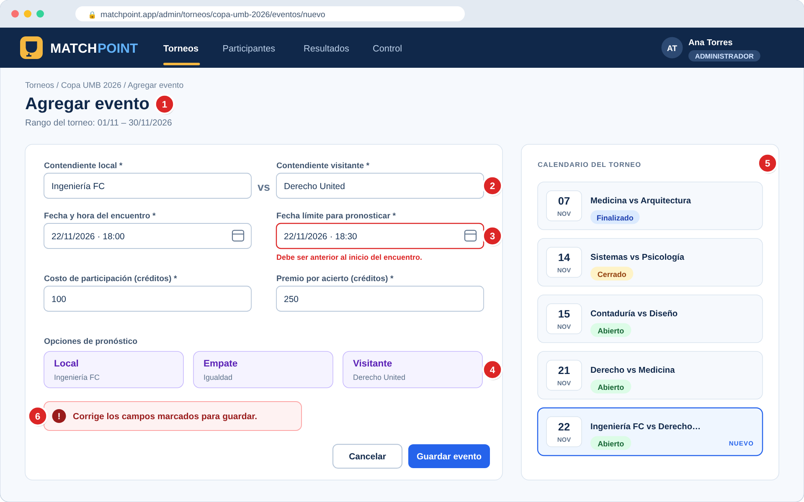  
SVG editable: `descargas/mockups/HU006_mockup.svg`

> **Nota:** El costo y el premio se configuran por evento porque el enunciado no fija valores.

### HU007 · Consultar torneos y eventos

**Épica:** Pronósticos · **Actividad:** Explorar eventos · **Prioridad:** Must · **Sprint 1** · **Puntos:** 3 · **Responsable propuesto:** Diego Romero · Frontend Developer · **Dependencias:** HU006

| **Identificador** | **HU007** |
|---|---|
| Nombre | Consultar torneos y eventos |
| Descripción | Como participante quiero consultar los torneos activos y sus eventos para conocer en qué puedo pronosticar, hasta cuándo y con qué costo. La HU corresponde a la funcionalidad principal del sistema. |
| Criterios de aceptación | 1. Al ingresar al panel de participante, el sistema deberá mostrar la lista de torneos activos con nombre, deporte y fechas. |
|  | 2. Al seleccionar un torneo, el sistema mostrará sus eventos con contendientes, fecha, fecha límite, costo y premio. |
|  | 3. Cada evento mostrará su estado («Abierto», «Cerrado» o «Finalizado»); solo los eventos abiertos tendrán habilitado el botón «Pronosticar». |
|  | 4. El participante podrá filtrar los eventos por estado. |
|  | 5. En caso que no existan torneos activos, el sistema mostrará el mensaje «No hay torneos disponibles por el momento». |

**Mockup:** Panel del participante con torneos activos, eventos, estados y filtro.  
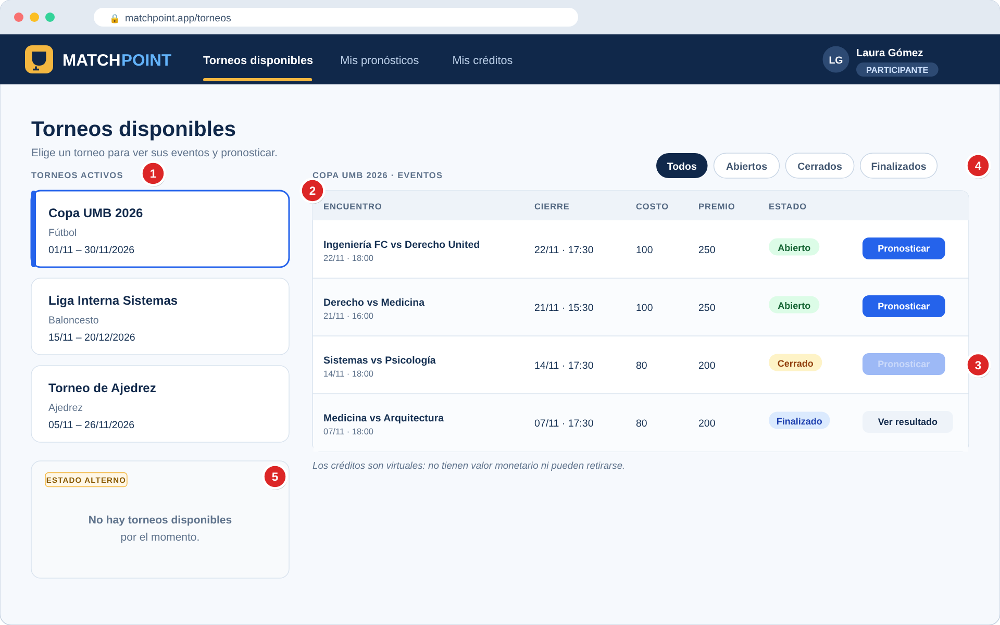  
SVG editable: `descargas/mockups/HU007_mockup.svg`

### HU008 · Registrar pronóstico

**Épica:** Pronósticos · **Actividad:** Pronosticar y seguir · **Prioridad:** Must · **Sprint 1** · **Puntos:** 8 · **Responsable propuesto:** Maicol Rubiano · Backend Developer · **Dependencias:** HU007, HU009

| **Identificador** | **HU008** |
|---|---|
| Nombre | Registrar pronóstico |
| Descripción | Como participante quiero registrar un pronóstico en un evento abierto para participar usando mis créditos virtuales. La HU corresponde a la funcionalidad principal del sistema. |
| Criterios de aceptación | 1. Al seleccionar la opción «Pronosticar» en un evento abierto, el sistema deberá mostrar las opciones válidas, el costo en créditos y el saldo disponible. |
|  | 2. Al elegir una opción, el sistema validará que el evento siga abierto, que el participante no tenga ya un pronóstico en ese evento y que su saldo sea suficiente. |
|  | 3. Si los datos son válidos, el sistema presentará un cuadro de diálogo con el resumen (evento, opción, costo y saldo resultante) pidiendo confirmar la transacción. |
|  | 4. Al confirmar la operación, el sistema registrará el pronóstico y descontará los créditos en una sola transacción; si una parte falla, ninguna se aplica. |
|  | 5. Si el participante presiona «Confirmar» varias veces o la solicitud se repite, solo se registrará un pronóstico y un descuento. |
|  | 6. En caso que el saldo sea insuficiente o el plazo haya vencido, el sistema indicará el motivo y no realizará ningún descuento. |
|  | 7. El participante puede elegir cancelar la operación, por lo que no se registra el pronóstico ni se descuentan créditos. |

**Mockup:** Detalle del evento con opciones, diálogo de confirmación y estado de saldo insuficiente.  
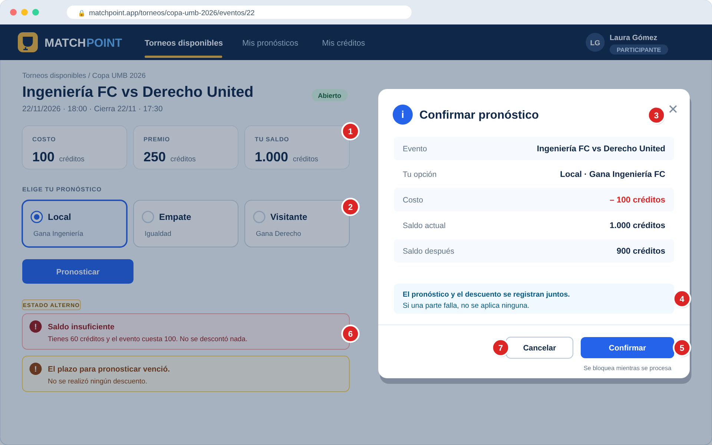  
SVG editable: `descargas/mockups/HU008_mockup.svg`

> **Nota:** Incluye atomicidad e idempotencia: nunca saldo negativo ni descuentos duplicados.

### HU009 · Asignar créditos iniciales

**Épica:** Créditos virtuales · **Actividad:** Asignar créditos · **Prioridad:** Must · **Sprint 1** · **Puntos:** 3 · **Responsable propuesto:** Camilo Bastidas · Database Administrator (DBA) · **Dependencias:** HU002

| **Identificador** | **HU009** |
|---|---|
| Nombre | Asignar créditos iniciales |
| Descripción | Como administrador quiero que cada participante reciba automáticamente su saldo inicial de créditos virtuales para que pueda participar desde su registro. La HU corresponde a la funcionalidad principal del sistema. |
| Criterios de aceptación | 1. Al registrar un nuevo participante (HU002), el sistema deberá asignarle automáticamente el saldo inicial configurado (por ejemplo, 1.000 créditos). |
|  | 2. La asignación quedará registrada como un movimiento de tipo «Asignación inicial» con fecha, participante y cantidad. |
|  | 3. En caso que se intente asignar el saldo inicial por segunda vez, el sistema deberá indicar que la asignación ya fue aplicada y no sumará créditos. |
|  | 4. El administrador podrá consultar el valor del saldo inicial configurado; los créditos son virtuales y no tienen valor monetario ni pueden retirarse. |
|  | 5. En caso de error en la asignación, no deberá quedar un participante registrado sin saldo: se notifica el error y la operación completa se revierte. |

**Mockup:** Detalle del participante con saldo inicial, movimiento de asignación y bloqueo de doble asignación.  
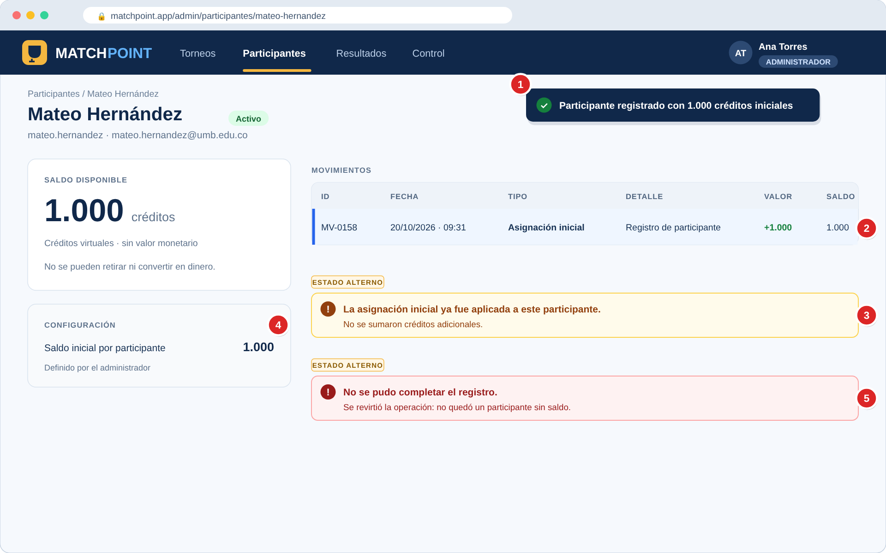  
SVG editable: `descargas/mockups/HU009_mockup.svg`

### HU010 · Consultar saldo y movimientos

**Épica:** Créditos virtuales · **Actividad:** Consultar y ajustar saldo · **Prioridad:** Must · **Sprint 1** · **Puntos:** 3 · **Responsable propuesto:** Diego Romero · Frontend Developer · **Dependencias:** HU009

| **Identificador** | **HU010** |
|---|---|
| Nombre | Consultar saldo y movimientos |
| Descripción | Como participante quiero consultar mi saldo y mis movimientos de créditos para verificar cada descuento y cada premio. La HU corresponde a la funcionalidad principal del sistema. |
| Criterios de aceptación | 1. Al seleccionar la opción «Mis créditos», el sistema deberá mostrar el saldo disponible actualizado. |
|  | 2. Debajo del saldo se listarán los movimientos propios del más reciente al más antiguo, con fecha, tipo, detalle, valor y saldo resultante. |
|  | 3. Los cargos se mostrarán con signo negativo y los abonos con signo positivo, diferenciados por color. |
|  | 4. El saldo mostrado deberá coincidir con la suma de los movimientos registrados. |
|  | 5. En caso que el participante intente consultar los movimientos de otra cuenta, el sistema deberá responder «Acceso no autorizado» sin mostrar datos. |

**Mockup:** Pantalla «Mis créditos» con saldo, movimientos coloreados y verificación de suma.  
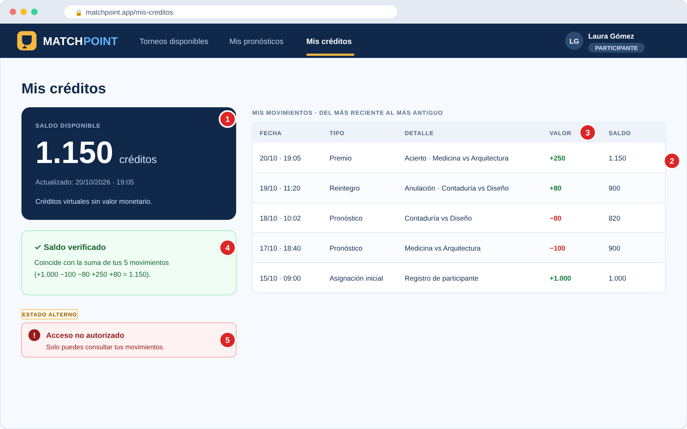  
SVG editable: `descargas/mockups/HU010_mockup.svg`

> **Nota:** Protege la información de otras cuentas desde el primer sprint.

### HU011 · Consultar mis pronósticos

**Épica:** Pronósticos · **Actividad:** Pronosticar y seguir · **Prioridad:** Must · **Sprint 2** · **Puntos:** 3 · **Responsable propuesto:** Diego Romero · Frontend Developer · **Dependencias:** HU008

| **Identificador** | **HU011** |
|---|---|
| Nombre | Consultar mis pronósticos |
| Descripción | Como participante quiero consultar mis pronósticos y su estado para saber cuáles están pendientes, cuáles acerté y qué premio recibí. La HU corresponde a la funcionalidad principal del sistema. |
| Criterios de aceptación | 1. Al seleccionar la opción «Mis pronósticos», el sistema deberá mostrar la lista de pronósticos del participante con torneo, evento, opción elegida, créditos y estado. |
|  | 2. Los estados posibles serán «Pendiente», «Acertado», «No acertado» y «Anulado», cada uno con un color distinto. |
|  | 3. Al seleccionar un pronóstico, el sistema mostrará su detalle con la fecha de registro y, si existe, el resultado oficial y el premio recibido. |
|  | 4. El sistema solo mostrará los pronósticos del usuario autenticado. |
|  | 5. En caso que el participante no tenga pronósticos, el sistema mostrará un mensaje con acceso a «Torneos disponibles». |

**Mockup:** Lista «Mis pronósticos» con estados y panel de detalle con resultado y premio.  
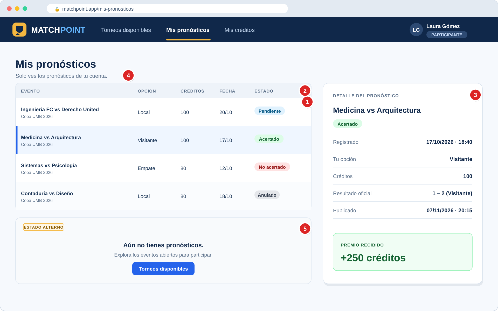  
SVG editable: `descargas/mockups/HU011_mockup.svg`

### HU012 · Anular pronóstico

**Épica:** Pronósticos · **Actividad:** Pronosticar y seguir · **Prioridad:** Should · **Sprint 2** · **Puntos:** 5 · **Responsable propuesto:** Maicol Rubiano · Backend Developer · **Dependencias:** HU008, HU011

| **Identificador** | **HU012** |
|---|---|
| Nombre | Anular pronóstico |
| Descripción | Como participante quiero anular un pronóstico antes de la fecha límite para recuperar mis créditos si cambio de decisión, siempre y cuando el evento siga abierto. La HU corresponde a la funcionalidad de gestión del sistema. |
| Criterios de aceptación | 1. Al seleccionar la opción «Anular» en un pronóstico pendiente, el sistema deberá validar si el evento sigue abierto. |
|  | 2. Si el evento sigue abierto, el sistema le presentará un cuadro de diálogo pidiendo confirmar la anulación e indicando los créditos que se reintegrarán. |
|  | 3. Al confirmar la operación, el pronóstico pasará a estado «Anulado» y se registrará un movimiento de reintegro por el mismo valor descontado. |
|  | 4. El participante puede elegir cancelar la operación, por lo que el pronóstico deberá seguir activo sin cambios. |
|  | 5. En caso que la fecha límite ya haya pasado, el sistema deberá indicarle que no es posible anular el pronóstico porque el evento está cerrado. |
|  | 6. Si la solicitud de anulación se repite, el sistema no generará un segundo reintegro. |

**Mockup:** Mis pronósticos con diálogo de anulación y mensaje de evento cerrado.  
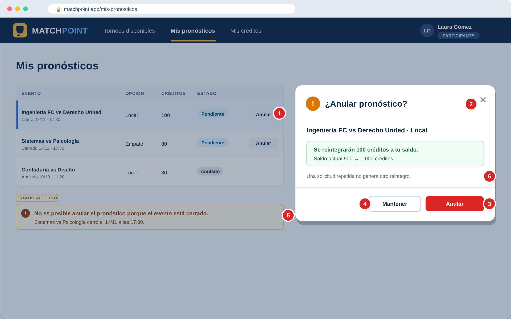  
SVG editable: `descargas/mockups/HU012_mockup.svg`

### HU013 · Cerrar recepción de pronósticos

**Épica:** Resultados y liquidación · **Actividad:** Cerrar y publicar · **Prioridad:** Must · **Sprint 2** · **Puntos:** 3 · **Responsable propuesto:** Maicol Rubiano · Backend Developer · **Dependencias:** HU006, HU008

| **Identificador** | **HU013** |
|---|---|
| Nombre | Cerrar recepción de pronósticos |
| Descripción | Como administrador quiero que la recepción de pronósticos se cierre en la fecha límite para que nadie pronostique cuando el evento ya comenzó. La HU corresponde a la funcionalidad principal del sistema. |
| Criterios de aceptación | 1. Al llegar la fecha límite de un evento, el sistema deberá cambiar automáticamente su estado a «Cerrado». |
|  | 2. El administrador también podrá seleccionar «Cerrar pronósticos» en un evento abierto; el sistema le presentará un cuadro de diálogo pidiendo confirmar. |
|  | 3. Una vez cerrado el evento, el sistema rechazará cualquier pronóstico nuevo o anulación sobre ese evento. |
|  | 4. El evento cerrado mostrará la cantidad de pronósticos recibidos por cada opción. |
|  | 5. El administrador puede elegir cancelar la operación, por lo que el evento deberá seguir abierto. |

**Mockup:** Lista de eventos con cierre automático, diálogo de cierre manual y distribución de pronósticos.  
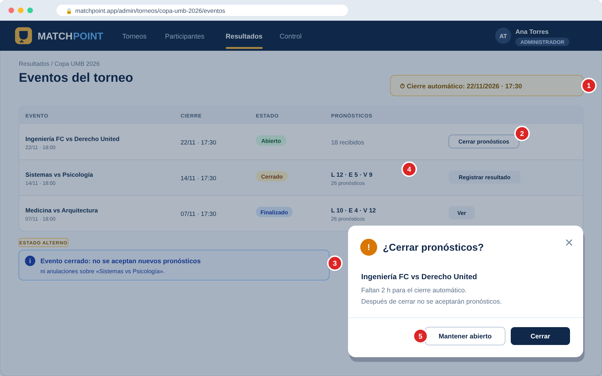  
SVG editable: `descargas/mockups/HU013_mockup.svg`

### HU014 · Publicar resultado oficial

**Épica:** Resultados y liquidación · **Actividad:** Cerrar y publicar · **Prioridad:** Must · **Sprint 2** · **Puntos:** 3 · **Responsable propuesto:** Maicol Rubiano · Backend Developer · **Dependencias:** HU013

| **Identificador** | **HU014** |
|---|---|
| Nombre | Publicar resultado oficial |
| Descripción | Como administrador quiero publicar el resultado oficial de un evento cerrado para que los pronósticos puedan liquidarse. La HU corresponde a la funcionalidad principal del sistema. |
| Criterios de aceptación | 1. Al seleccionar la opción «Registrar resultado» en un evento cerrado, el sistema deberá mostrar el formulario con el marcador y la opción ganadora. |
|  | 2. El sistema solo permitirá registrar resultados a usuarios con rol administrador y sobre eventos en estado «Cerrado». |
|  | 3. Antes de publicar, el sistema presentará un cuadro de diálogo con el resultado pidiendo confirmar la transacción. |
|  | 4. Al confirmar la operación, el evento pasará a estado «Finalizado» y el resultado quedará visible para los participantes. |
|  | 5. En caso que el evento siga abierto, el sistema deberá indicar que primero debe cerrarse la recepción de pronósticos. |
|  | 6. Un resultado publicado no podrá sobrescribirse; cualquier cambio se hará con la corrección controlada (HU016). |

**Mockup:** Formulario de resultado con opción ganadora, diálogo de publicación y bloqueo de evento abierto.  
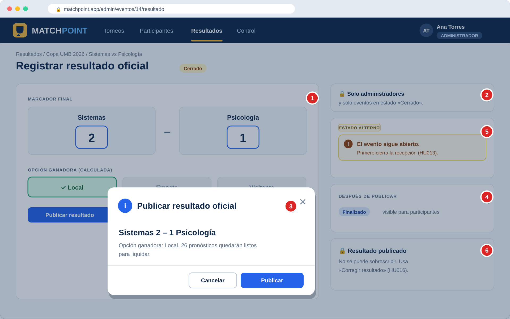  
SVG editable: `descargas/mockups/HU014_mockup.svg`

### HU015 · Liquidar evento y acreditar premios

**Épica:** Resultados y liquidación · **Actividad:** Liquidar y corregir · **Prioridad:** Must · **Sprint 2** · **Puntos:** 8 · **Responsable propuesto:** Maicol Rubiano · Backend Developer · **Dependencias:** HU014

| **Identificador** | **HU015** |
|---|---|
| Nombre | Liquidar evento y acreditar premios |
| Descripción | Como administrador quiero liquidar un evento finalizado para acreditar los premios de los pronósticos acertados una sola vez. La HU corresponde a la funcionalidad principal del sistema. |
| Criterios de aceptación | 1. Al seleccionar la opción «Liquidar» en un evento finalizado, el sistema deberá identificar los pronósticos acertados según el resultado oficial. |
|  | 2. El sistema mostrará un resumen previo (pronósticos totales, acertados, no acertados y créditos a acreditar) pidiendo confirmar la transacción. |
|  | 3. Al confirmar la operación, el sistema acreditará el premio de cada pronóstico acertado y marcará los demás como «No acertado» en una sola transacción. |
|  | 4. Cada premio generará un movimiento de tipo «Premio» vinculado al pronóstico y al evento. |
|  | 5. En caso que la liquidación se ejecute de nuevo, el sistema deberá indicar que el evento ya fue liquidado y no acreditará premios duplicados. |
|  | 6. En caso de error durante la liquidación, no se aplicará ningún abono parcial y se notificará al administrador. |

**Mockup:** Resumen de liquidación con indicadores, ganadores y aviso de evento ya liquidado.  
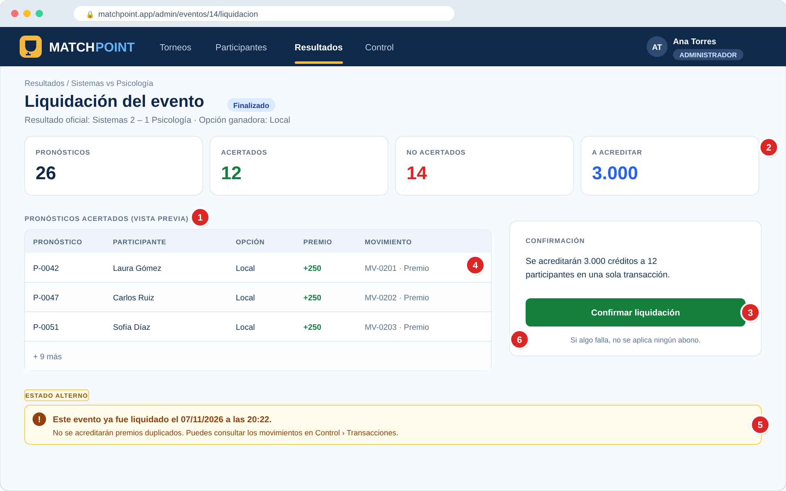  
SVG editable: `descargas/mockups/HU015_mockup.svg`

> **Nota:** Idempotencia de liquidación: repetirla no duplica premios.

### HU016 · Corregir resultado publicado

**Épica:** Resultados y liquidación · **Actividad:** Liquidar y corregir · **Prioridad:** Should · **Sprint 2** · **Puntos:** 5 · **Responsable propuesto:** Camilo Bastidas · Database Administrator (DBA) · **Dependencias:** HU015

| **Identificador** | **HU016** |
|---|---|
| Nombre | Corregir resultado publicado |
| Descripción | Como administrador quiero corregir un resultado publicado por error para recalcular los premios sin borrar el historial de lo ocurrido. La HU corresponde a la funcionalidad de control del sistema. |
| Criterios de aceptación | 1. Al seleccionar la opción «Corregir resultado» en un evento finalizado, el sistema deberá solicitar el nuevo resultado y un motivo obligatorio. |
|  | 2. El sistema presentará un cuadro de diálogo indicando cuántos premios se revertirán y cuántos se acreditarán, pidiendo confirmar la transacción. |
|  | 3. Al confirmar la operación, se registrarán movimientos de reversión y de nuevo premio; ningún movimiento anterior se elimina. |
|  | 4. La corrección quedará en el historial con resultado anterior, resultado nuevo, motivo, usuario y fecha. |
|  | 5. El administrador puede elegir cancelar la operación, por lo que el resultado y los saldos deberán seguir sin cambios. |
|  | 6. En caso que una reversión deje algún saldo en negativo, el sistema no aplicará la corrección e informará al administrador las cuentas afectadas. |

**Mockup:** Formulario de corrección con motivo, diálogo de impacto e historial de correcciones.  
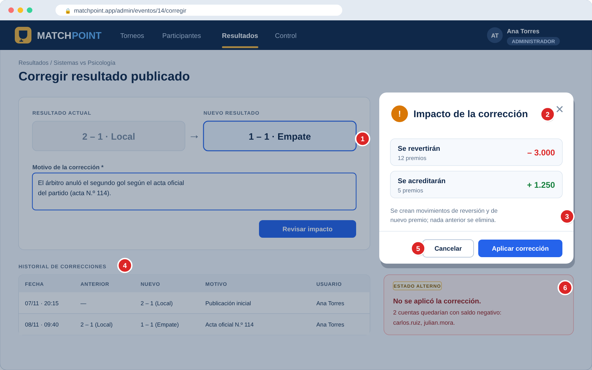  
SVG editable: `descargas/mockups/HU016_mockup.svg`

### HU017 · Ajustar créditos autorizados

**Épica:** Créditos virtuales · **Actividad:** Consultar y ajustar saldo · **Prioridad:** Should · **Sprint 2** · **Puntos:** 5 · **Responsable propuesto:** Camilo Bastidas · Database Administrator (DBA) · **Dependencias:** HU010

| **Identificador** | **HU017** |
|---|---|
| Nombre | Ajustar créditos autorizados |
| Descripción | Como responsable de control quiero registrar ajustes de créditos justificados para corregir saldos de forma trazable. La HU corresponde a la funcionalidad de control del sistema. |
| Criterios de aceptación | 1. Al seleccionar la opción «Ajustar créditos» en el detalle de un participante, el sistema deberá mostrar el formulario con tipo (abono o cargo), cantidad y motivo obligatorio. |
|  | 2. El sistema validará que la cantidad sea mayor que cero y que un cargo no deje el saldo en negativo. |
|  | 3. Antes de aplicar, el sistema presentará un cuadro de diálogo con el saldo actual y el saldo resultante pidiendo confirmar la transacción. |
|  | 4. Al confirmar la operación, se registrará un movimiento de tipo «Ajuste» con autor, motivo y fecha, y el saldo se actualizará. |
|  | 5. El responsable puede elegir cancelar la operación, por lo que el saldo deberá seguir igual. |
|  | 6. Solo los usuarios con permiso de control podrán ver y usar esta opción. |

**Mockup:** Diálogo de ajuste con tipo, cantidad, motivo y saldo resultante.  
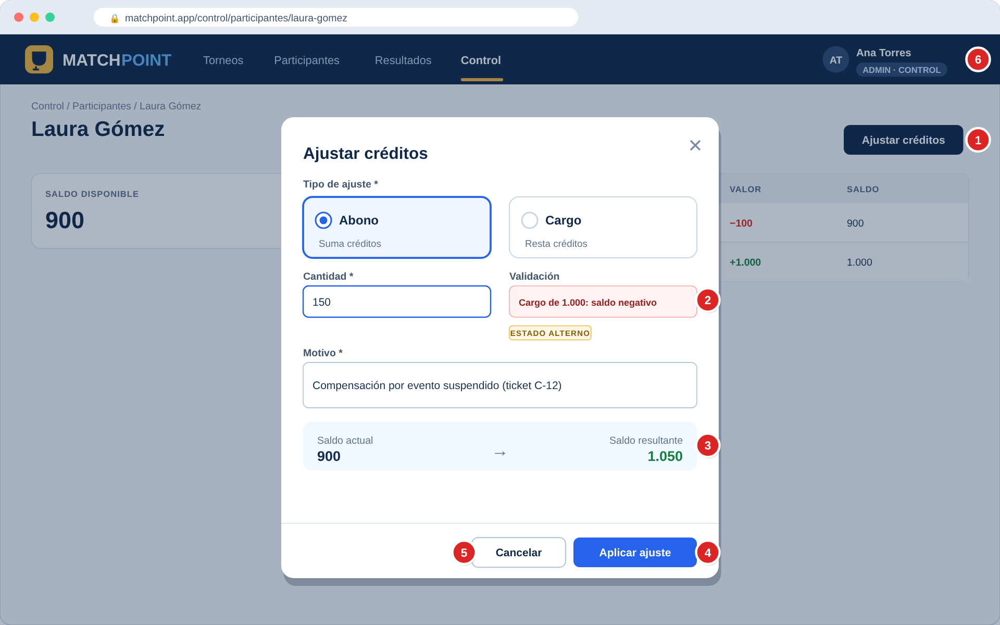  
SVG editable: `descargas/mockups/HU017_mockup.svg`

### HU018 · Consultar transacciones

**Épica:** Auditoría y reportes · **Actividad:** Auditar movimientos · **Prioridad:** Must · **Sprint 2** · **Puntos:** 5 · **Responsable propuesto:** Camilo Bastidas · Database Administrator (DBA) · **Dependencias:** HU010

| **Identificador** | **HU018** |
|---|---|
| Nombre | Consultar transacciones |
| Descripción | Como responsable de control quiero consultar todas las transacciones de créditos para verificar su origen y detectar errores. La HU corresponde a la funcionalidad de control del sistema. |
| Criterios de aceptación | 1. Al seleccionar la opción «Transacciones» en el panel de control, el sistema deberá listar los movimientos con identificador, fecha, usuario, tipo, valor y origen. |
|  | 2. El responsable podrá filtrar por participante, tipo de movimiento, evento y rango de fechas. |
|  | 3. Al seleccionar un movimiento, el sistema mostrará su detalle y el registro que lo originó (pronóstico, premio, ajuste o reversión). |
|  | 4. Los movimientos no podrán editarse ni eliminarse desde esta pantalla. |
|  | 5. En caso que no existan resultados para los filtros aplicados, el sistema mostrará el mensaje «Sin movimientos para los filtros seleccionados». |

**Mockup:** Tabla de transacciones con filtros y panel de detalle de solo lectura.  
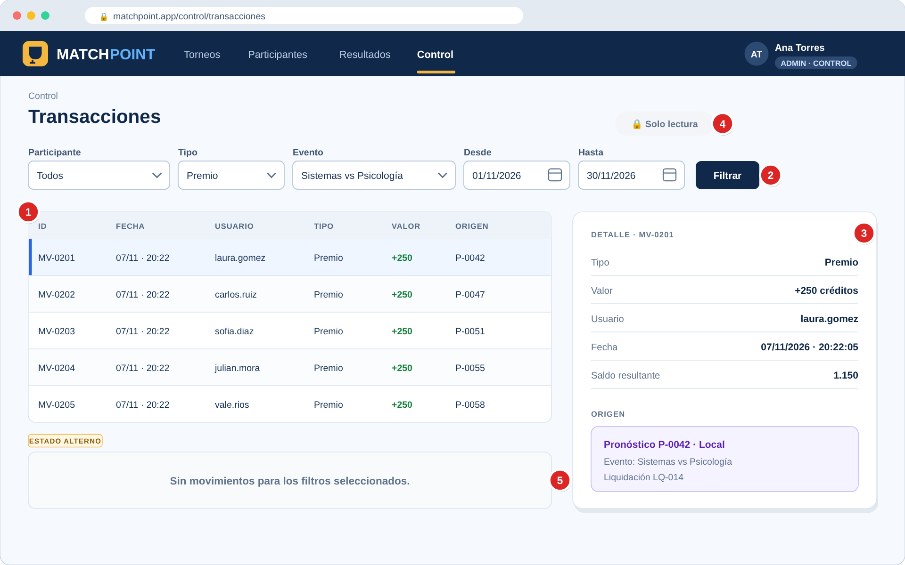  
SVG editable: `descargas/mockups/HU018_mockup.svg`

### HU019 · Conciliar saldos

**Épica:** Auditoría y reportes · **Actividad:** Auditar movimientos · **Prioridad:** Could · **Sprint 2** · **Puntos:** 3 · **Responsable propuesto:** Camilo Bastidas · Database Administrator (DBA) · **Dependencias:** HU018

| **Identificador** | **HU019** |
|---|---|
| Nombre | Conciliar saldos |
| Descripción | Como responsable de control quiero comparar cada saldo con la suma de sus movimientos para detectar inconsistencias. La HU corresponde a la funcionalidad de control del sistema. |
| Criterios de aceptación | 1. Al seleccionar la opción «Ejecutar conciliación», el sistema deberá recalcular el saldo de cada participante a partir de sus movimientos. |
|  | 2. El sistema mostrará una tabla con saldo registrado, saldo calculado y diferencia por participante. |
|  | 3. Las cuentas con diferencia se resaltarán como «Inconsistente» y las demás como «Correcto». |
|  | 4. La conciliación no modifica saldos: solo informa; las correcciones se hacen con el ajuste autorizado (HU017). |
|  | 5. El resultado de la conciliación podrá descargarse en formato CSV. |

**Mockup:** Tabla de conciliación con diferencias resaltadas y descarga CSV.  
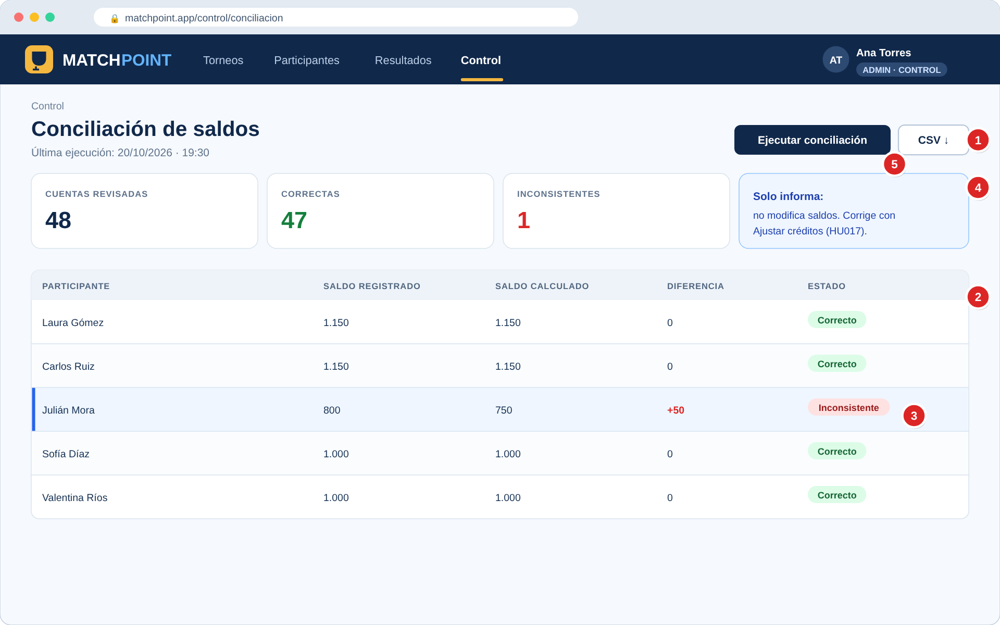  
SVG editable: `descargas/mockups/HU019_mockup.svg`

### HU020 · Generar reporte del torneo

**Épica:** Auditoría y reportes · **Actividad:** Consolidar información · **Prioridad:** Could · **Sprint 2** · **Puntos:** 3 · **Responsable propuesto:** Diego Romero · Frontend Developer · **Dependencias:** HU015

| **Identificador** | **HU020** |
|---|---|
| Nombre | Generar reporte del torneo |
| Descripción | Como administrador quiero generar un reporte del torneo para conocer la participación, los aciertos y los créditos utilizados y entregados. La HU corresponde a la funcionalidad de consulta del sistema. |
| Criterios de aceptación | 1. Al seleccionar la opción «Reporte» en un torneo, el sistema deberá mostrar el resumen de eventos, pronósticos, aciertos, créditos usados y créditos entregados como premio. |
|  | 2. El administrador podrá filtrar el reporte por rango de fechas del torneo. |
|  | 3. Los totales del reporte deberán coincidir con los movimientos registrados. |
|  | 4. El reporte podrá descargarse en PDF o CSV. |
|  | 5. En caso que el torneo no tenga eventos liquidados, el sistema indicará que el reporte aún no tiene resultados. |

**Mockup:** Reporte del torneo con indicadores, gráfico por evento y descargas.  
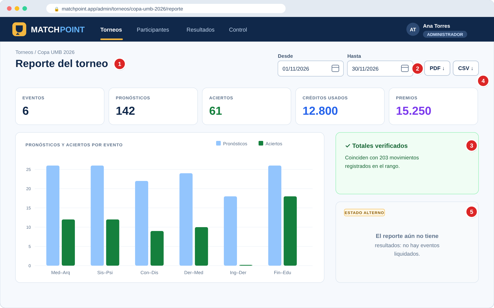  
SVG editable: `descargas/mockups/HU020_mockup.svg`

## Reglas transversales

1. Los permisos por rol y la privacidad de la información propia se aplican desde el Sprint 1 (HU001, HU010).
2. Los créditos nunca quedan negativos; descuento y registro del pronóstico son una sola transacción (HU008).
3. Las solicitudes repetidas no duplican descuentos, reintegros ni premios (HU008, HU012, HU015).
4. Todo movimiento tiene identificador, fecha, usuario, tipo, valor y origen (HU009, HU018).
5. Las correcciones generan movimientos compensatorios; el historial no se elimina (HU016, HU017).
6. Un torneo con eventos asociados no se elimina (HU005).

## Pendientes de validación con la docente

- Confirmar la duración y las fechas de los dos sprints.
- Confirmar el saldo inicial de créditos y los valores de costo y premio por evento (el enunciado no los fija).
- Decidir si las historias Could (HU019, HU020) se mantienen en el Sprint 2.
- Acordar el Product Owner y los responsables finales.

## Fuente

Enunciado de *MatchPoint - Plataforma de gestión de torneos, pronósticos y créditos virtuales* facilitado por el curso y mapa de historias de usuario del mismo equipo (HU001 a HU020).
